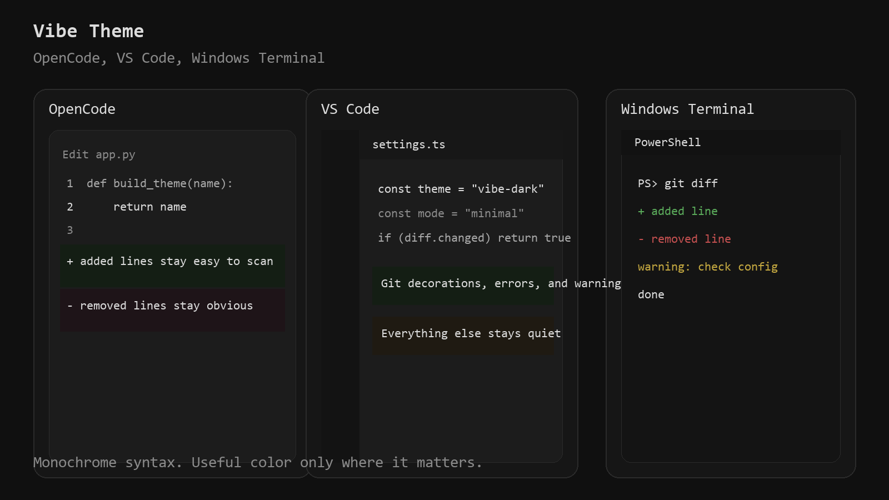
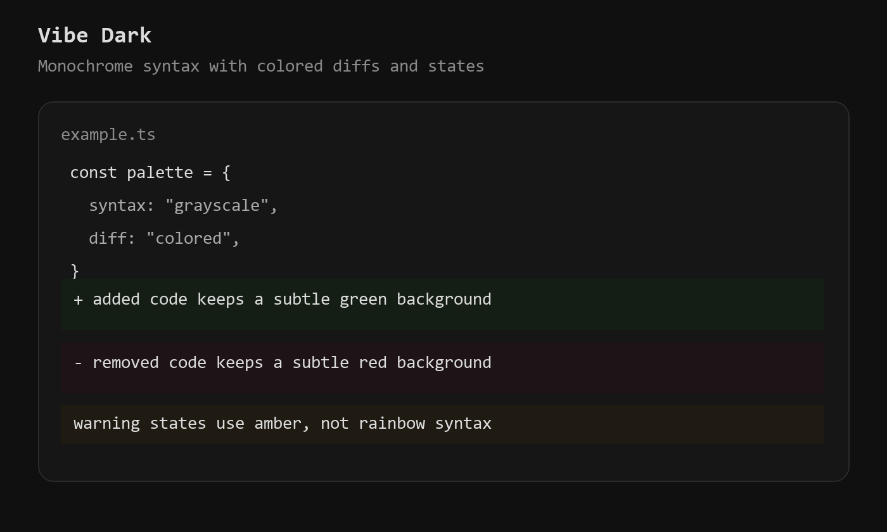
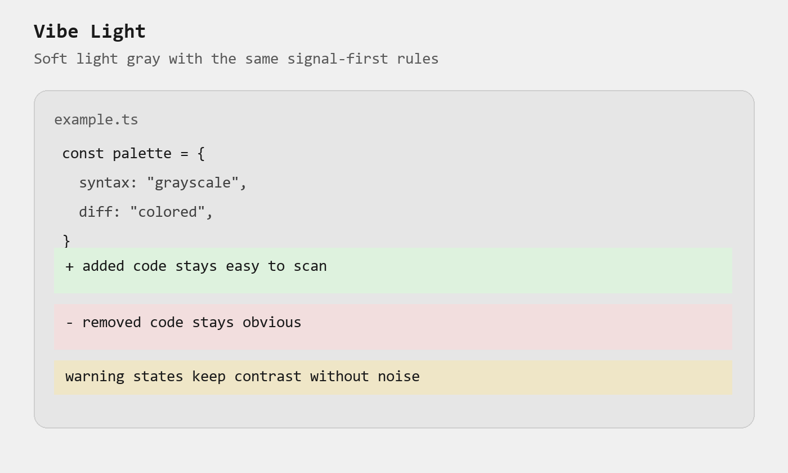

# Vibe Theme

Minimal monochrome themes for OpenCode, VS Code, and Windows Terminal.



- Syntax stays grayscale
- Diffs, errors, warnings, and git states keep color
- Includes dark and light variants

## Supported Apps

| App | Status | Setup |
| --- | --- | --- |
| OpenCode | Supported | [docs/opencode.md](docs/opencode.md) |
| VS Code | Supported | [docs/vscode.md](docs/vscode.md) |
| Windows Terminal | Supported | [docs/windows-terminal.md](docs/windows-terminal.md) |

## Install

### OpenCode

```bash
mkdir -p ~/.config/opencode/themes
cp opencode/vibe-dark.json opencode/vibe-light.json ~/.config/opencode/themes/
```

Then run `/theme` and choose `vibe-dark` or `vibe-light`.

### Windows Terminal

Open the JSON settings file from Windows Terminal and add `windows-terminal/vibe-dark.json` or `windows-terminal/vibe-light.json` to the `schemes` array.

Set it as the default scheme:

```json
"profiles": {
  "defaults": {
    "colorScheme": "Vibe Dark"
  }
}
```

### VS Code

From `vscode/`:

```bash
npx @vscode/vsce package
code --install-extension vibe-theme-1.0.0.vsix
```

Then open the theme picker and choose `Vibe Dark` or `Vibe Light`.

## Preview





## Prompt For Your AI

```text
Install the Vibe Theme from https://github.com/jasprcodess/vibe-theme across my setup. Apply the matching theme to OpenCode, VS Code, and Windows Terminal. Use Vibe Dark unless I already use light themes.
```

## License

MIT
