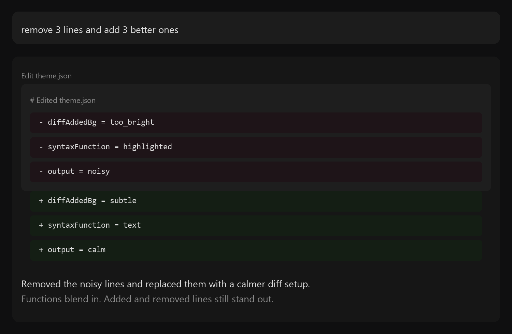
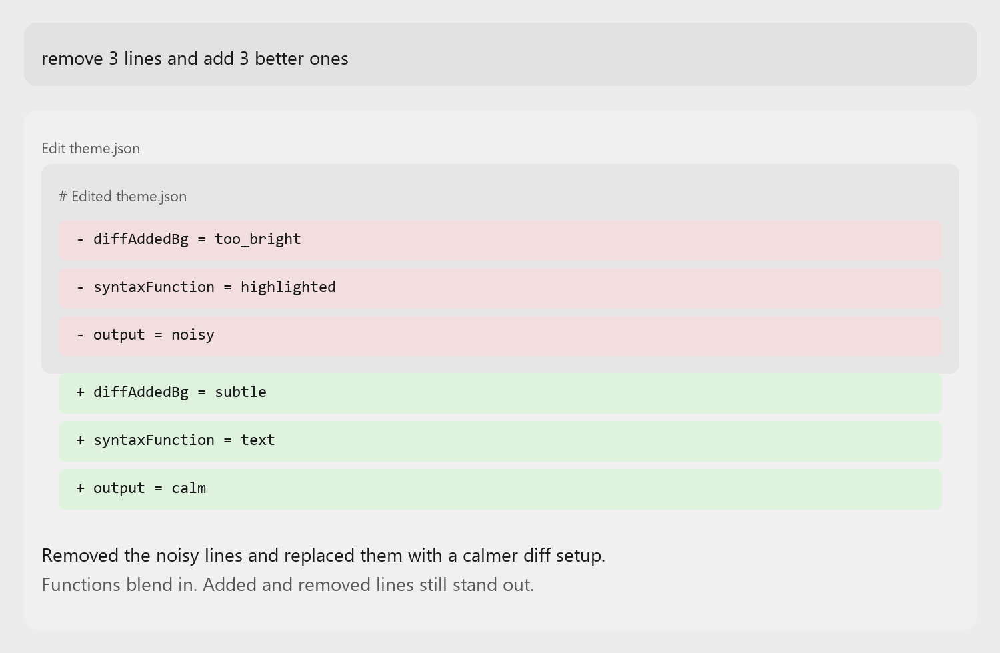

# Vibe Theme

A minimal monochrome theme set.





Syntax stays grayscale. Diffs, errors, warnings, and git states keep their color.

This repo ships a few ready-to-use ports and a shared palette for making more.

Terminal tools that inherit terminal colors will pick up the terminal scheme. Anything else needs its own native port.

## Prompt

```text
Install Vibe Theme across my setup. Use the included ports where available, use the terminal scheme for terminal-based tools, and default to Vibe Dark unless I already use light themes.
```

## Install

### OpenCode

```bash
mkdir -p ~/.config/opencode/themes
cp opencode/vibe-dark.json opencode/vibe-light.json ~/.config/opencode/themes/
```

Then run `/theme` and choose `vibe-dark` or `vibe-light`.

### Windows Terminal

Open the JSON settings file from Windows Terminal and add `windows-terminal/vibe-dark.json` or `windows-terminal/vibe-light.json` to the `schemes` array.

Set it as the default scheme:

```json
"profiles": {
  "defaults": {
    "colorScheme": "Vibe Dark"
  }
}
```

### VS Code

From `vscode/`:

```bash
npx @vscode/vsce package
code --install-extension vibe-theme-1.0.0.vsix
```

Then open the theme picker and choose `Vibe Dark` or `Vibe Light`.

Docs:

- [OpenCode](docs/opencode.md)
- [VS Code](docs/vscode.md)
- [Windows Terminal](docs/windows-terminal.md)

Palette and rules:

- [palette.json](palette.json)

## License

MIT
